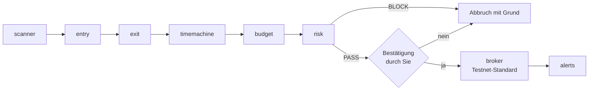

# Binance Day Trader

Claude-Skills für Krypto-Day-Trading auf dem Binance Spot-Markt (USDT-Paare wie BTCUSDT, ETHUSDT): Charts scannen, den Einstieg timen, Stop, Ziel und spätestes Ausstiegsdatum vorher festlegen, den Trade 10.000-mal durchspielen, die Größe inklusive Gebühren berechnen, gegen Ihre Limits prüfen und erst nach Ihrem ausdrücklichen Ja an Binance senden. Standard ist das **Spot-Testnet**.

Dies ist ein Fork von [github.com/Jakeschincariol/day-trader-skill](https://github.com/Jakeschincariol/day-trader-skill) (MIT, Copyright (c) 2026 Jake Schincariol). Die Architektur ist dieselbe: eine Pipeline aus Skills, die über den Ordner `trader/` Daten austauschen. Datenquelle und Broker sind jetzt Binance statt Yahoo Finance und Alpaca. Lizenz: siehe `LICENSE` (unverändert).

> **Nur Werkzeug, keine Anlageberatung.** Die meisten Day-Trader verlieren Geld. Krypto handelt rund um die Uhr, schwankt stark und kennt keine Handelsaussetzung, die Sie schützt. Lesen Sie den Abschnitt [Risiken](#risiken), bevor Sie echtes Geld einsetzen.

## Ablauf



| Befehl | Aufgabe |
| --- | --- |
| `/trader-setup` | Einrichtung: Config anlegen, `trader/` aus git ausschließen, Keys (nur ob vorhanden), Testnet-Verbindung und Konto prüfen. |
| `/trader-scanner` | Universum aller handelbaren USDT-Spot-Paare, Tages-Setups und Opening-Range-Breakouts in Ihrer UTC-Sitzung. |
| `/trader-entry` | Beobachtet ein Setup Kerze für Kerze und meldet den Einstiegsmoment. |
| `/trader-exit` | Stop und Ziel auf der Tick-Größe des Symbols, `exit_by` = Einstieg + `max_hold_minutes`, Chance-Risiko vor und nach Gebühren. |
| `/trader-timemachine` | 10.000 Simulationen der Haltezeit aus den eigenen Kerzen des Coins plus die Regel auf allen vergangenen Sitzungen, ehrlich mit Wahrscheinlichkeiten und R nach Gebühren. |
| `/trader-budget` | Positionsgröße in Bruchteilen (`stepSize`), Preise auf `tickSize`, Mindest-Notional, Max-Verlust inklusive beider Gebühren. |
| `/trader-risk` | PASS oder BLOCK mit Begründung: Verlust, Tageslimit, Trades pro Tag, Chance-Risiko, Größe, USDT, Binance-Filter, Eintragsfenster. |
| `/trader-broker` | Ticket in Klartext, Ihr Ja, dann Einstieg und sofort die OCO (Ziel und Stop). Testnet standardmäßig. |
| `/trader-alerts` | Alarme für Stop, Ziel und das Erreichen von `max_hold_minutes`, Sitzungsuhr, Kurse. |

**Nicht genutzt** (unverändert aus dem Aktien-Original, nicht in der Pipeline, nicht gelöscht):

| Befehl | warum nicht |
| --- | --- |
| `/trader-news` | liest US-Aktien-News (Yahoo, SEC 8-K); optional, siehe [Krypto-News](#krypto-news-vorschläge) |
| `/trader-analyst` | Quartalszahlen von US-Firmen; Coins haben keine |
| `/trader-pelosi` | Aktiengeschäfte von US-Kongressmitgliedern |

## Schnellstart in Claude Code (empfohlen)

Voraussetzungen: [Claude Code](https://code.claude.com) und Python 3.8 oder neuer. Nichts zu installieren.

1. **Testnet-Keys** auf https://testnet.binance.vision anlegen (Login mit GitHub, „Generate HMAC_SHA256 Key“).
2. **Keys in Ihrem Terminal setzen**, bevor Sie Claude Code starten (nie in den Chat einfügen):

   ```bash
   export BINANCE_API_KEY="..."
   export BINANCE_API_SECRET="..."
   ```

3. **Arbeitsordner anlegen und Claude Code starten:**

   ```bash
   mkdir -p ~/trading && cd ~/trading && claude
   ```

4. **Plugin installieren**, in Claude Code:

   ```
   /plugin marketplace add MaxKnacks-Claude/TradeHilfe
   /plugin install binance-day-trader@binance-day-trader
   ```

   Danach Claude Code neu starten. Die Skills heißen dann `/binance-day-trader:trader-setup` usw.; Sie können aber auch einfach in Worten fragen („scan Binance nach Breakouts“).
5. **Einrichten lassen:** „Richte die Trading-Skills ein“ bzw. `/binance-day-trader:trader-setup`. Das legt `trader/config.json` an (Testnet), schließt `trader/` aus git aus und prüft Keys, Testnet-Verbindung und Konto, ohne die Keys je anzuzeigen.
6. **Ausprobieren:** nach 00:15 UTC (Ende der Opening Range) „Scan Binance nach Opening-Range-Breakouts“, dann die Pipeline wie unten.

Das Plugin bringt einen **Hook** mit (`hooks/hooks.json`): Vor jedem `ticket.py place` und `protect` fragt Claude Code Sie zusätzlich um Erlaubnis, und Befehle, die Ihre API-Keys ausgeben würden (`echo $BINANCE_API_SECRET`, `env`), werden blockiert. Dafür müssen Sie nichts einstellen.

### Alternativ: Ordner kopieren

```bash
git clone https://github.com/MaxKnacks-Claude/TradeHilfe.git
cp -r TradeHilfe/common TradeHilfe/trader-* ~/.claude/skills/
```

**`common/` muss mitkopiert werden.** Ohne Plugin gibt es den Hook nicht: Übernehmen Sie dann `trader-broker/claude_settings.example.json` in `.claude/settings.json`.

### Alternativ: Claude-App (claude.ai)

`python3 tools/build_skill_zips.py` baut nach `dist/` je Skill eine ZIP-Datei mit eigenem `common/`, hochzuladen unter Einstellungen → Fähigkeiten → Skills. Einschränkungen: Die Skripte laufen dort in Anthropics Sandbox, deren Netzwerk Binance eventuell nicht erreicht, und Ihre Keys lägen nicht in Ihrer eigenen Umgebung. Zum Handeln ist Claude Code der richtige Weg; in der App eignen sich die Skills vor allem zum Kennenlernen mit den Offline-Daten.

## Einrichtung (Testnet)

Mit dem Plugin erledigt `/trader-setup` die Schritte 3 und 5. Von Hand:

1. **Testnet-Key anlegen:** auf https://testnet.binance.vision mit einem GitHub-Konto anmelden und dort einen HMAC-API-Key erzeugen. Testnet-Keys sind getrennt von echten Keys und handeln mit Spielgeld.
2. **Keys nur als Umgebungsvariablen**, nie in einer Datei im Repo, nie im Chat:

   ```bash
   export BINANCE_API_KEY="..."
   export BINANCE_API_SECRET="..."
   ```

   Die Tools lesen sie nur aus der Umgebung und geben sie nie aus, auch nicht teilweise. Eine `trader/config.json`, die Keys enthält, wird abgelehnt.
3. **Konfiguration:** `mkdir -p trader && cp config.example.json trader/config.json`, dann Ihre Zahlen eintragen. `trader/` steht in `.gitignore` und wird nie eingecheckt.
4. **Rückfrage vor jeder Order:** Den Inhalt von `trader-broker/claude_settings.example.json` in `.claude/settings.json` übernehmen. Dann fragt Claude Code vor jedem `ticket.py place` und `protect` noch einmal nach. Diese Befehle nie auf „allow“ setzen.
5. **Prüfen:** `python3 trader-broker/ticket.py account` zeigt die Testnet-Guthaben (nur lesend).

## API-Key für echtes Geld

Wenn Sie irgendwann live handeln wollen, legen Sie auf binance.com einen **eigenen** Key an:

- **nur** „Enable Spot & Margin Trading“ (bzw. Spot-Handel) aktivieren, nichts anderes,
- **„Enable Withdrawals“ AUS**, kein Margin, keine Futures, kein Universal Transfer,
- **IP-Beschränkung** auf Ihre feste IP („Restrict access to trusted IPs only“),
- Key und Secret nur als Umgebungsvariablen, und den Key sofort widerrufen, wenn er je in einem Chat, Log oder Repo gelandet ist.

Der Code selbst kann keine Auszahlungen, kein Margin, keine Futures und keinen Hebel: Der gemeinsame Client lässt nur eine feste Liste von Spot-Endpunkten zu, alles andere (`/sapi`, `/fapi`, Withdraw ...) wird abgelehnt, bevor ein Byte gesendet wird. Ein Test stellt das sicher.

## Konfiguration (`trader/config.json`)

| Schlüssel | Standard | Bedeutung |
| --- | --- | --- |
| `testnet` | `true` | `false` nur für Live, und dann zusätzlich `--live` bei jedem Aufruf |
| `market_data` | `"trading"` | Chartdaten vom selben Ort wie die Orders; `"live"` liest echte Marktdaten (ohne Key), auch wenn auf dem Testnet gehandelt wird |
| `quote_asset` | `"USDT"` | Quote-Währung, alle Geldbeträge darin |
| `symbols` | BTC, ETH, SOL, BNB, XRP | Watchlist, solange es kein `trader/universe.txt` gibt |
| `budget`, `cash_buffer_pct` | 1000, 10 | Budget und Cash-Puffer |
| `max_position_pct`, `max_order`, `min_order` | 50, 500, 10 | Größenlimits |
| `max_loss_per_trade` | 10 | Max-Verlust pro Trade am Stop, **inklusive Gebühren** |
| `max_daily_loss`, `max_trades_per_day`, `max_orders_per_day` | 30, 3, 10 | Tageslimits (pro Sitzung) |
| `min_reward_risk` | 1.5 | Mindest-Chance-Risiko **nach Gebühren** |
| `fee_rate` | 0.001 | Handelsgebühr pro Seite (0,1 %) |
| `stop_limit_offset_pct` | 0.5 | Limit unter dem Stop, falls ein Symbol keine STOP_LOSS-Order kennt |
| `session_start_utc` | `"00:00"` | Beginn der 24-Stunden-Sitzung (UTC) |
| `opening_range_minutes` | 15 | Länge der Opening Range |
| `entry_window_minutes` | 360 | neue Einstiege nur bis so viele Minuten nach Sitzungsbeginn |
| `max_hold_minutes` | 240 | spätestens so lange nach dem Einstieg raus, Gewinn oder Verlust |
| `history_days` | 60 | Historie für die Timemachine |
| `min_quote_volume_24h` | 5.000.000 | Volumenfilter für das Scanner-Universum |
| `exclude_leveraged_tokens`, `exclude_stable_pairs` | `true` | BTCUP/ETHBEAR und Stablecoin-Paare raus |
| `blocked` | `[]` | Symbole, die nie gehandelt werden |

**Sitzung:** Krypto läuft 24/7, also legt die Config die „Sitzung“ fest. Sie beginnt täglich um `session_start_utc` und dauert 24 Stunden. Eine Sitzung, die um 22:00 UTC beginnt, läuft über Mitternacht und heißt nach dem Tag ihres Beginns. Alle Zeiten intern und in der Ausgabe sind UTC.

**Gebühren:** Binance zieht die Kaufgebühr in der gekauften Coin ab. Wer 0,00948 BTC kauft, erhält 0,00947052 BTC; die OCO kann deshalb nur 0,00947 verkaufen. Budget, Risk und Broker rechnen mit genau diesem Betrag. Ein enger Stop macht die Gebühren teuer: Bei 0,35 % Stop-Abstand sind gut die Hälfte des Verlusts Gebühren, und aus 1,5R werden nach Gebühren 0,59R.

## Befehle

```bash
python3 trader-scanner/scan.py universe                       # handelbare USDT-Paare -> trader/universe.txt
python3 trader-scanner/scan.py orb                            # Breakouts der laufenden Sitzung
python3 trader-entry/entry.py check BTCUSDT --write           # -> trader/entry.json
python3 trader-exit/exit.py plan --target 4R --write          # -> trader/plan.json
python3 trader-timemachine/timemachine.py run --write         # 10.000 Simulationen + Historie
python3 trader-budget/size.py --write                         # -> trader/orders.json (Kauf + OCO)
python3 trader-risk/check.py                                  # PASS / BLOCK
python3 trader-broker/ticket.py show                          # das Ticket
python3 trader-broker/ticket.py approve --index 1 --reply "yes"
python3 trader-broker/ticket.py place --index 1 --confirm <Code>
python3 trader-alerts/alerts.py add --from-plan               # Stop, Ziel, exit_by
python3 trader-alerts/alerts.py check
python3 trader-broker/ticket.py flatten --symbol BTCUSDT      # bei exit_by: OCO stornieren, verkaufen
```

## Keine Order ohne Ihre Bestätigung

`ticket.py place` sendet nur, wenn **alle drei** Bedingungen erfüllt sind:

1. `/trader-risk` hat **genau diese Order** (per Fingerprint) in dieser Sitzung mit PASS geprüft. Jede Änderung an Menge oder Preis braucht eine neue Prüfung.
2. Sie haben **für genau diese Order** ausdrücklich „yes“ (oder „ja“) geschrieben. „ok“, „sure“, „yes to all“, ein Ja mit Bedingung oder eines, das ein anderes Paar oder eine andere Menge nennt, zählt nicht. `approve` gibt dann einen **Einmal-Code** aus (gespeichert nur als Hash).
3. `place` wird mit diesem Code **innerhalb von 5 Minuten** aufgerufen. Der Code gilt einmal und nur für das Ziel, für das das Ja gegeben wurde (ein Testnet-Ja platziert nie live).

Ein Ja gilt für das Paket aus Einstieg und Schutz-OCO, denn ohne OCO wäre die Position ungeschützt. Binance kennt keine Bracket-Order: `place` kauft (`POST /api/v3/order`), liest die tatsächlich erhaltene Menge und setzt sofort die OCO (`POST /api/v3/orderList/oco`, Ziel als LIMIT_MAKER, Stop als STOP_LOSS bzw. STOP_LOSS_LIMIT). Lehnt Binance die OCO ab, meldet das Tool laut **UNPROTECTED** und versucht nichts automatisch erneut.

Die Tests beweisen das offline gegen eine nachgebaute Börse: Ohne PASS, ohne Ja, mit falschem oder abgelaufenem Code, nach einer Änderung der Order oder beim Wechsel Testnet/Live wird **kein einziger** Order-Aufruf gesendet.

## Testnet-Durchlauf (scanner bis broker)

So prüfen Sie die ganze Kette mit Spielgeld:

```bash
mkdir -p trader && cp config.example.json trader/config.json
python3 trader-broker/ticket.py account                       # Testnet-Guthaben
python3 trader-scanner/scan.py orb                            # nach dem Ende der Opening Range
python3 trader-entry/entry.py check BTCUSDT --write           # oder watch, bis es auslöst
python3 trader-exit/exit.py plan --target 3R --write
python3 trader-timemachine/timemachine.py run --write
python3 trader-budget/size.py --write
python3 trader-risk/check.py
python3 trader-broker/ticket.py validate --index 1             # Binance prüft die Kauforder, nichts wird platziert
python3 trader-broker/ticket.py show
python3 trader-broker/ticket.py approve --index 1 --reply "yes"
python3 trader-broker/ticket.py place --index 1 --confirm <Code>
python3 trader-broker/ticket.py status                        # Kauf FILLED, OCO EXECUTING
python3 trader-alerts/alerts.py add --from-plan && python3 trader-alerts/alerts.py check
```

Hinweise zum Testnet:
- Das Testnet hat eigene Preise und dünne Orderbücher, und es wird gelegentlich zurückgesetzt. Seine Kurse können vom echten Markt abweichen, und die Timemachine findet dort eventuell zu wenig Historie (sie sagt dann klar „needs at least 20“).
- Die Stop- und Zielpreise müssen zum **Testnet**-Kurs passen, sonst lehnt Binance die OCO ab. Deshalb liest `market_data: "trading"` die Kerzen vom Testnet selbst.
- Für eine kleine Position: `budget` z. B. auf 100 und `max_position_pct` auf 20 setzen. Achten Sie aber auf das Mindest-Notional (meist 5 USDT pro OCO-Bein), sonst lehnt budget ab.

**Stand dieses Umbaus:** Aus der Bau-Umgebung war kein Binance-Host erreichbar. Der Durchlauf ist offline gegen eine nachgebaute Börse getestet (`tests/test_pipeline.py`, `tests/test_broker.py`), **gegen das echte Testnet noch nicht.** Bitte führen Sie den Durchlauf oben einmal aus, bevor Sie sich auf das Werkzeug verlassen.

## Live gehen

Live ist allein Ihre Entscheidung. Es braucht **beides**: `"testnet": false` in `trader/config.json` **und** `--live` bei jedem Aufruf, der Binance anspricht. Fehlt eines davon, verweigert der Client. Ein Ja, das für ein Testnet-Ticket gegeben wurde, platziert nie live.

## Risiken

- **Keine Anlageberatung.** Das Werkzeug liest Daten und rechnet. Es kennt Ihre Lage nicht und sieht nicht in die Zukunft. Sie können Geld verlieren, auch mehr als geplant.
- **Krypto handelt 24/7** und schwankt stark. Eine Nachricht, ein Hack, ein Delisting oder eine Liquidationskaskade kann den Kurs in Sekunden bewegen.
- **Ein Stop ist ein Plan, keine Garantie.** STOP_LOSS füllt zum Marktpreis, in schnellen Märkten deutlich schlechter. STOP_LOSS_LIMIT kann bei einem Kurssprung **gar nicht** füllen, dann ist die Position ungeschützt.
- **Zwischen Kauf und OCO** liegt ein kurzer Moment ohne Schutz. Scheitert die OCO, meldet das Tool das laut; Sie müssen dann handeln (`protect` oder `flatten`).
- **Gebühren und Staub:** Bei kleinen Positionen frisst die Rundung auf den `stepSize` einen ganzen Step. Budget lehnt solche Trades ab, kleine Reste („Dust“) bleiben trotzdem im Konto.
- **Die Timemachine ist eine Simulation, keine Vorhersage.** Sie baut nur aus den letzten 60 Tagen. Die Beispielstrategie verliert in ihren eigenen Daten nach Gebühren, und das Tool sagt das auch so.
- **Rate-Limits:** Zu viele Anfragen führen zu HTTP 429 und bei Wiederholung zu einer IP-Sperre (418, 2 Minuten bis 3 Tage). Der Client drosselt selbst und wiederholt nie stumpf.
- **Börsenrisiko:** Guthaben auf einer Börse sind nicht wie Bankeinlagen geschützt.
- **Steuern:** Gewinne aus Krypto-Verkäufen können steuerpflichtig sein (in Deutschland u. a. private Veräußerungsgeschäfte bei Haltedauer unter einem Jahr). Dies ist keine Steuerberatung.

## Krypto-News (Vorschläge)

`/trader-news` ist für Aktien gebaut und bleibt vorerst deaktiviert. Für Krypto kämen diese frei nutzbaren Quellen in Frage. Keine davon ist eingebaut; das geschieht erst nach Ihrer Zustimmung, und die Nutzungsbedingungen wären vorher zu prüfen:

1. **CoinDesk RSS**: allgemeine Krypto-Nachrichten als RSS-Feed, ohne Key.
2. **Cointelegraph RSS**: Nachrichten-Feeds, auch nach Themen, ohne Key.
3. **CryptoPanic API**: aggregierte Schlagzeilen pro Coin (z. B. BTC, ETH), mit kostenlosem Token; passt am besten zur Watchlist, braucht aber einen eigenen Key.

## Tests

```bash
python3 -m unittest discover -s tests -v
```

Alle Tests laufen offline: `tests/_load.py` sperrt jeden Netzwerkzugriff, ein Test, der ins Netz will, schlägt fehl. Geprüft werden unter anderem:
- die Kerzen-Normalisierung,
- die Rundung auf `stepSize`/`tickSize`,
- die Gebühren im Max-Verlust,
- jeder BLOCK-Fall von risk,
- die Sitzung über Mitternacht UTC,
- die Signatur gegen das offizielle Beispiel der Binance-Doku,
- Rate-Limits (429/418),
- die Freigabe-Sperren des Brokers,
- ein kompletter Pipeline-Durchlauf.

**Die Fixtures sind synthetisch** (`tests/fixtures/binance/README.md`): Sie haben exakt das dokumentierte Format der Binance-Antworten, die Kurse sind aber ein gesetzter Zufallspfad, weil die Bau-Umgebung Binance nicht erreichen konnte. `python3 tests/record_fixtures.py` zeichnet auf einem Rechner mit Zugang echte öffentliche Antworten auf (ohne Key). Danach müssen die Erwartungswerte einiger Tests angepasst werden.

## Dateien

```
.claude-plugin/      plugin.json, marketplace.json
hooks/               hooks.json, order_guard.py (Rückfrage vor jeder Order, keine Keys ausgeben)
trader-setup/        SKILL.md, setup.py
tools/               build_skill_zips.py (ZIPs für die Claude-App)
common/              binance_client.py, symbol_filters.py, trading_session.py, trader_config.py, order_math.py
config.example.json  Vorlage für trader/config.json (ohne Keys)
trader-scanner/      SKILL.md, scan.py
trader-entry/        SKILL.md, entry.py
trader-exit/         SKILL.md, exit.py
trader-timemachine/  SKILL.md, timemachine.py
trader-budget/       SKILL.md, size.py
trader-risk/         SKILL.md, check.py
trader-broker/       SKILL.md, ticket.py, claude_settings.example.json
trader-alerts/       SKILL.md, alerts.py, alerts.example.json
trader-news/         nicht genutzt (Aktien-News)
trader-analyst/      nicht genutzt (Quartalszahlen)
trader-pelosi/       nicht genutzt (Kongress-Trades)
tests/               unittest-Suite, Binance-Fixtures, record_fixtures.py
```

MIT-Lizenz, siehe `LICENSE`. Original: [Jake Schincariol](https://opusjake.ai), [day-trader-skill](https://github.com/Jakeschincariol/day-trader-skill).
